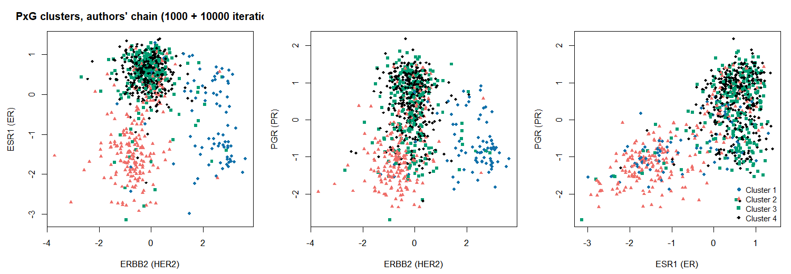
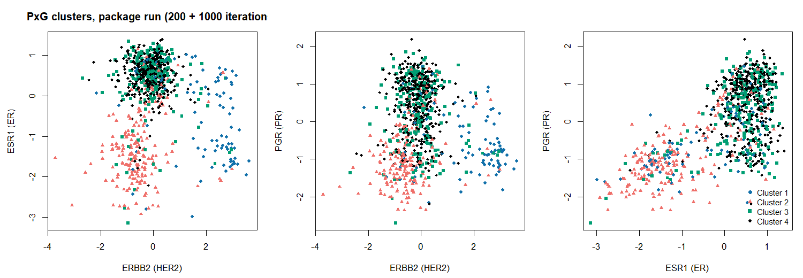
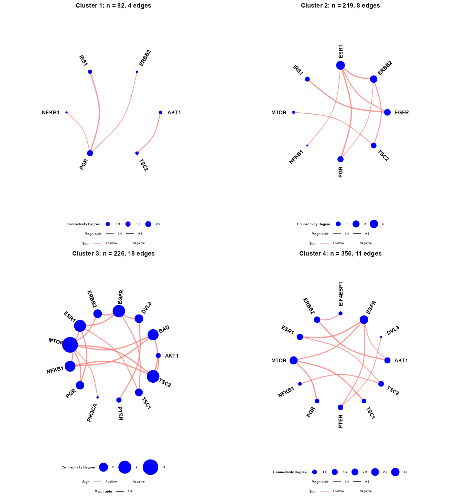
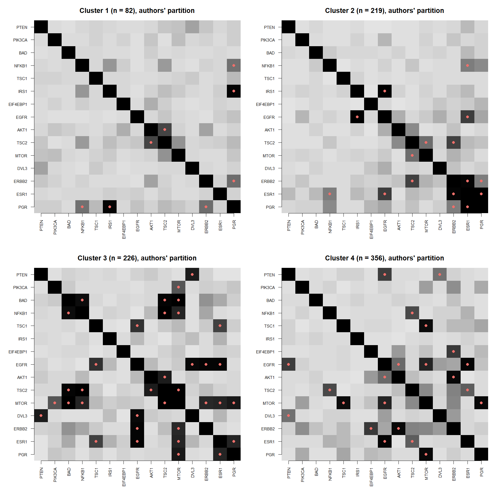

# covassistedGM: Covariate-Assisted Bayesian Graph Learning for Heterogeneous Data (PxG)

[](https://github.com/sagnikbhadury/cov_assistedGM/actions/workflows/R-CMD-check.yaml)

An R package built from the JASA reproducibility supplement of

> Niu, Y., Ni, Y., Pati, D. and Mallick, B. K. (2024). Covariate-Assisted Bayesian Graph
> Learning for Heterogeneous Data. *Journal of the American Statistical Association*,
> 119(547), 1985-1999. [doi:10.1080/01621459.2023.2233744](https://doi.org/10.1080/01621459.2023.2233744).
> [arXiv:2308.07806](https://arxiv.org/abs/2308.07806). JASA reproducibility award 2024.

The supplement (R and C++ scripts, TCGA breast cancer data, saved results, four R Markdown
workflows) is the only public distribution of the authors' code. This package makes it
installable and documented **without changing a numerical statement of the authors'
samplers**, adds the comparison methods of the paper from the same supplement, the data, data
generators for the simulation studies, post-processing and network-drawing helpers, four
vignettes and scripts that reproduce every figure and number of the paper. The complete
original supplement is shipped verbatim under `inst/original_supplement/`.

The method, the code of the samplers and the breast cancer data are the authors'. The
packaging, documentation, helpers and vignettes were added by Sagnik Bhadury. License: MIT, as
declared by the authors in the supplement's Author Contributions Checklist.

## The model in one paragraph

Samples have a response vector $y_i \in \mathbb{R}^q$, whose conditional-independence graph is
of interest, and covariates $x_i \in \mathbb{R}^p$ believed to shape that graph. PxG
("partition times graph") puts a truncated Dirichlet process on the samples whose allocation is
driven jointly by $y$ (through a Gaussian graphical model per cluster) and by $x$ (through a
Gaussian auxiliary model per cluster), so samples with similar covariates are encouraged to
share a graph, and the graph may differ between clusters. Two specifications are provided: a
Gaussian / G-Wishart sampler in R for small graphs (`PxG_GW`) and a pseudo-likelihood
spike-and-slab neighbourhood-selection sampler in C++ for larger graphs (`PxG_PL`). Each has a
covariate-only and a graph-only reduced model for DIC comparison. See
`vignette("pxg-model")`.

## Installation

```r
# install.packages("remotes")
remotes::install_github("sagnikbhadury/cov_assistedGM", build_vignettes = TRUE)
```

Needs a C++14 compiler (Rtools on Windows). Imports: Rcpp, RcppArmadillo, BDgraph, invgamma,
igraph, ggplot2, ggraph. Suggested: huge (k-lasso), glmnet and glasso (JRNS initialisation),
ggpubr, knitr, rmarkdown, testthat. The mSSL competitor is a GitHub package
(`remotes::install_github("skdeshpande91/multivariate_SSL", subdir = "mSSL")`) and is wrapped,
not vendored.

## What is in the package

| | Functions | Origin |
|---|---|---|
| PxG, G-Wishart specification | `PxG_GW`, `CovOnly_GW`, `GraphOnly_GW`, `GraphEst` | authors' `PxG-GW.R`, unchanged code |
| PxG, pseudo-likelihood specification (C++) | `PxG_PL`, `CovOnly_PL`, `GraphOnly_PL`, `Graph_NS` | authors' `PxG-PL.cpp`, unchanged code |
| BM13 competitor (C++) | `LSGraph`, `MCMCGraph`, `HIWsim`, `meanOmegaHIW` | authors' `LSGraph_0.1.tar.gz` |
| JRNS competitor (C++) | `JRNS`, `StepB`, `StepOmega`, `jrns_initial_values`, `jrns_edge_frequencies` | `JRNS.zip` of the supplement (Samanta, Khare and Michailidis 2022) |
| k-lasso competitor | `klasso`, `kernel_mc`, `ekernel` | authors' code in `Example1.R` |
| mSSL competitor | `fit_mSSL` | wrapper around the GitHub package |
| Data | `brca_rna` (883 x 3), `brca_rppa` (883 x 15) | TCGA, as distributed by the authors |
| Simulation data | `simulate_example1`, `simulate_example2`, `simulate_example3` | data blocks of the three example scripts |
| Post-processing | `symmetrize_graph`, `cluster_graphs`, `cluster_edge_probabilities`, `partial_correlation_path`, `within_cluster_ss` | reproduce the scripts' inline post-processing |
| Figures | `plot_edge_heatmap`, `Network_VisualizationSB`, `pxg_network_matrix`, `plot_pxg_networks`, `plot_cluster_network` | heat maps as in the paper; network drawing from Sagnik Bhadury's `Network Visualization.R` |

Everything that was changed in the authors' sources for packaging is listed in
`src/README_sources.md`: C++14 compilation (current RcppArmadillo refuses the original C++11
plugin, so the supplement's `sourceCpp()` calls fail on an up-to-date R), `std::cout` routed
to `Rcpp::Rcout` behind a `verbose` argument, namespace-qualified calls, and the three JRNS
files merged into one translation unit. Nothing in the samplers' arithmetic, priors, updates
or random-number calls was touched.

## Quick start: the breast cancer analysis

```r
library(covassistedGM)
data(brca_rna); data(brca_rppa)   # 883 TCGA tumours; X = ERBB2, ESR1, PGR mRNA; Y = 15 proteins (RPPA)

# the authors' call from RealDataAnalysis.R (1000 + 10000 iterations takes ~3 min and 62 GB, see below)
set.seed(2022)
fit <- PxG_PL(YData = brca_rppa, XData = brca_rna,
              spike = 0.01, slab = 1, a1 = 1, a2 = 1, alphaG = 0.5,
              mu0 = rep(0, 3), sigsq0 = 1, b1 = 30, b2 = 0.1,
              M = 10, N = 4, burnin = 200, nmcmc = 1000, z0 = sample(1:4, 883, TRUE), B = 1,
              verbose = FALSE)
table(fit$Label)

# one graph per cluster, as the authors do (Graph_NS, max-rule symmetrisation, cutoff 0.5)
graphs <- cluster_graphs(brca_rppa, fit$Label, spike = 0.1, slab = 5, alphaG = 0.5,
                         burnin = 100, nmcmc = 1000, cutoff = 0.5, seed = 2022)
plot_edge_heatmap(graphs[["Cluster 1"]]$prob, main = "Cluster 1")              # paper Figure 12 style
plots <- plot_pxg_networks(graphs, title = "PxG cluster networks")             # Network_VisualizationSB
plots[["Cluster 1"]]
```

### Results

The authors' chain on the 883 tumours (seed 2022) gives the four clusters of the paper's
Figure 10. They line up with HER2-high tumours (cluster 1), ER/PR-low tumours (cluster 2) and
two ER/PR-high groups (clusters 3 and 4):



The package's reduced chain (200 + 1,000 iterations, same code and seed) places 87% of the
tumours in the same groups:



| | PxG | graph-only |
|---|---|---|
| DIC, authors' chain (paper) | 37,531 | 40,798 |
| DIC, package reduced chain | 37,509 | 43,426 |
| cluster sizes, authors' chain | 82 / 219 / 226 / 356 | 351 / 104 / 278 / 150 |
| cluster sizes, package chain | 94 / 194 / 211 / 384 | 291 / 97 / 368 / 127 |
| within-cluster SS of the covariates, authors' partitions | 359,896 | 618,250 |

Refitting each cluster's graph with `Graph_NS` on the authors' partition reproduces their
saved `probG1`-`probG4` matrices exactly (maximum absolute difference 0), so the packaged
C++ is the supplement's code. The four cluster networks, drawn with `Network_VisualizationSB`
(arc width = posterior edge probability, node size = summed probability of its edges,
proteins without a selected edge omitted):



Edge posterior probabilities as heat maps (the paper's Figure 12):



The same figures for the package's reduced-chain partition are `man/figures/brca_network_package_*.png`.
All numbers and figures above come from `reproduce/run_breast_cancer.R` and
`reproduce/make_network_figures.R`; the compact results are in
`inst/extdata/brca_pxg_results.rds` and are what `vignette("pxg-breast-cancer")` uses.

### Memory note

The authors' `*_PL` samplers keep an `n x n x nmcmc` integer array in memory for Dahl's (2006)
partition estimate. For the paper's chain (883 tumours, 10,000 kept draws) that is 62 GB; the
authors ran it on a Mac with memory compression. The code has deliberately been left as they
wrote it. On ordinary machines use a shorter chain (`n^2 * nmcmc * 8` bytes are needed; 1,000
kept draws is 6 GB and runs in about 20 seconds) and use the authors' saved full-chain
results, shipped in `inst/original_supplement/RData`, for the paper's numbers. On a machine
with enough memory, `PXG_FULL=TRUE Rscript reproduce/run_breast_cancer.R` runs the paper's chain.

## Verification against the supplement

Three checks that the packaged code is the supplement's code:

1. **Per-cluster graphs, breast cancer.** `Graph_NS` run on the authors' saved partition with
   the script's settings and seed reproduces their saved `probG1`-`probG4` matrices with a
   maximum absolute difference of 0 (`reproduce/run_breast_cancer.log`).
2. **Example 3, `PxG_PL`** with the paper's chain (500 + 1,000 iterations, n = 500, q = 50,
   seed 2022) against `Example3A.RData`.
3. **Example 1, `PxG_GW`** with the paper's chain (500 + 1,000 iterations, seed 2020) against
   `Example1A.RData`.

Checks 2 and 3 are run by `reproduce/verify_against_supplement.R`; the log and the saved
comparison (`reproduce/verify_against_supplement.log`, `reproduce/output/`) record whether the
labels, DIC and edge summaries are identical. A G-Wishart chain can differ from the authors'
only through the Monte Carlo normalising-constant approximation in `BDgraph::gnorm`, whose
random-number stream depends on the installed BDgraph version.

## Reproducing the paper

| Paper section | Vignette | Script (package functions) | Original script (verbatim) |
|---|---|---|---|
| 4.1 Example 1, 3 nodes | `vignette("pxg-simulations")` | `inst/scripts/Example1_package.R` | `inst/original_supplement/Code/Example1.R` |
| 4.2 Example 2, 5 nodes | `vignette("pxg-simulations")`, `vignette("competitors")` | `inst/scripts/Example2_package.R` | `Example2.R` |
| 4.3 Example 3, 50 nodes | `vignette("pxg-simulations")`, `vignette("competitors")` | `inst/scripts/Example3_package.R` | `Example3.R` |
| 5 Breast cancer | `vignette("pxg-breast-cancer")` | `inst/scripts/RealDataAnalysis_package.R`, `reproduce/run_breast_cancer.R` | `RealDataAnalysis.R` |

The vignettes run short chains live and load the authors' saved results for the paper's
figures, stating in each case which is which. The `inst/scripts` versions use the paper's chain
lengths and the authors' seeds. The authors' own R Markdown workflows and their rendered PDFs
are in `inst/original_supplement/RMarkdown/`.

## Notes on the original code

Reading the supplement line by line for this package turned up the following; nothing was
changed, each point is documented where it matters (details in `vignette("pxg-model")`):

1. `PxG-PL.cpp` requests C++11; current RcppArmadillo needs C++14, so the supplement's
   `sourceCpp()` fails on an up-to-date R. The package compiles the same code under C++14.
2. In `PxG-GW.R`, the helpers that add the covariate log likelihood to the DIC of `PxG_GW` and
   `CovOnly_GW` assign to a misspelt variable, so that term is always zero in those two
   models (not in `GraphOnly_GW`). The Example 1 DIC values in the paper are those of this code.
3. The posterior shape of the covariate variance is `b1 + n_k p / 2` in the R implementation
   and `b1 + n_k / 2` in the C++ implementation.
4. `GraphOnly_PL`'s DIC evaluates the covariate term with the prior-augmented total sum of
   squares rather than the residual sum of squares around the sampled mean.
5. `Graph_NS` runs `burnin + nmcmc - 1` iterations and divides by `nmcmc`.
6. The "total sum of squares" of Section 5 (509,029 and 645,585) comes from an expression
   that accumulates each cluster's sum of squares once per member and recycles the mean vector
   against the data matrix; `within_cluster_ss()` returns the plain quantity, the size-weighted
   one and the script's value.
7. The k-lasso competitor passes an increasing penalty grid to `huge`, which current versions
   reject; `klasso()` sorts the grid (same penalties).
8. `Example1.R` compares the k-lasso estimate of edge 1-2 with the truth of edge 2-3 in its
   third MSE (0.2266); with edge 2-3 on both sides the value differs.

## Citation

```r
citation("covassistedGM")
```

Please cite the paper for the method and the code. Bhadra and Mallick (2013) and Niu, Pati and
Mallick (2020) for BM13; Samanta, Khare and Michailidis (2022) for JRNS; Deshpande, Rockova and
George (2019) for mSSL; Liu, Chen, Wasserman and Lafferty (2010) for k-lasso.
